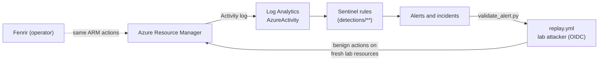

# Huggin

**Fenrir attacks Azure managed identities; Huggin proves Sentinel catches each logged step.**

Huggin is the defensive counterpart to [Fenrir](https://github.com/MarwenOnGit/fenrir), an Azure
security assessment tool for authorized tests and labs. Huggin is a set of Microsoft Sentinel
analytics rules for the actions Fenrir performs, deployed with Terraform, and proven every night
by replaying benign versions of those actions in a lab subscription and checking that the
expected alert appears.

> **Status (2026-11-04).** Four core rules are **validated**: each fired in two back-to-back
> benign replays with one alert per event. Everything else is a draft. The dated, honest record
> is [docs/STATUS.md](docs/STATUS.md); the coverage matrix is
> [docs/FENRIR-MAPPING.md](docs/FENRIR-MAPPING.md).



## What Huggin can and cannot see

Fenrir makes no writes. Its entire `AzureActivity` footprint is six POST actions: VM Run Command
(X-08), App Service publishing credentials (X-10), Logic App callback URL (X-13), Container
Instances exec (X-14), storage `listKeys` (P-12) and ACR `listCredentials` (P-13).

**Blind spots, stated plainly**
- **ARM reads are not logged** in `AzureActivity`. Fenrir's whole `enumerate` phase, `post-exploit`
  without dump flags, and the Automation Account path (X-15 to X-18: reading runbook source,
  variables and credential names) leave no trace in Sentinel.
- **Graph reconnaissance** (E-01 to E-07, X-06) is visible only with Entra ID P1/P2 and
  `MicrosoftGraphActivityLogs`. This tenant has no P1/P2.
- **What happens on a host** after Run Command or a container exec is not in control-plane logs.
  Huggin sees that a command was run, not what it did. The command text is not logged either
  (lab evidence X-08).

## Rules by tier

| Tier | Rule | Fenrir ops | Status |
|---|---|---|---|
| Core (`AzureActivity`, no licence) | `logicapp-callback-listed` | X-13 | **validated** 2026-11-03 |
| | `storage-keys-listed` | P-12 | **validated** 2026-11-03 (branch C: new caller-account pair) |
| | `fenrir-chain` | X-08, X-10, X-13, X-14, P-12, P-13 | **validated** 2026-11-03 (multi-stage branch) |
| | `vm-runcommand-by-user` | X-08 | **validated** 2026-11-03 |
| | `appservice-publish-creds` | X-10 | draft (opt-in lab batch after 11 November) |
| | `aci-exec` | X-14 | draft (opt-in lab batch) |
| | `acr-admin-creds-listed` | P-13 | draft (opt-in lab batch) |
| Identity (manual purple-team run) | `mi-control-plane-new-ip` | P-12, P-13 as the managed identity | draft, deployable (`AzureActivity` only) |
| | `mi-signin-anomaly` | host side of X-08, X-11 | written, **not deployable** (needs P1/P2) |
| | `devicecode-azure-mgmt-signin` | A-02, A-04 | written, **not deployable** (needs P1/P2) |
| | `graph-directory-recon` | E-01 to E-07, X-06 | written, **not deployable** (needs P1/P2) |
| Beyond Fenrir | `rbac-self-assignment`, `uai-attached-to-host`, `automation-runbook-run` | none | drafts. Next steps an operator would take after Fenrir reports the opportunity; Fenrir does not trigger them. |

Measured time to alert: 5 to 17 minutes (ingestion of `AzureActivity` takes 3 to 10 minutes,
plus the 5-minute rule schedule and Sentinel's 5-minute run delay).

## How it is tested

| Loop | When | Azure | What |
|---|---|---|---|
| [`ci.yml`](.github/workflows/ci.yml) | every push | no | static rule tests, KQL syntax (Microsoft's `Kusto.Language` parser), `terraform fmt`/`validate`, tflint, checkov |
| [`replay.yml`](.github/workflows/replay.yml) | nightly 02:30 UTC and on demand | yes | drift check (deployed rules = git), benign replays as the lab attacker on **fresh** resources, alert validation with time-to-alert, cleanup |
| [`evidence.yml`](.github/workflows/evidence.yml) | on demand | yes | one benign action per Fenrir operation, to capture the real log rows (`lab-evidence/`) |
| [Purple team](docs/PURPLE-TEAM.md) | manual | yes | a real Fenrir run against a disposable, fully logged environment (`infra/purple`): every table it touched is captured, canary secrets show which logs a stolen secret reaches |

Details: [docs/TESTING.md](docs/TESTING.md). Design: [docs/ARCHITECTURE.md](docs/ARCHITECTURE.md).
Interview walkthrough: [docs/DEMO.md](docs/DEMO.md).

## Quick start

Prerequisites: Terraform >= 1.6, Azure CLI with the `log-analytics` extension, Python 3.11+,
GitHub CLI, tflint, checkov. Owner on the subscription and Global Administrator on the tenant
(for the bootstrap only).

```bash
make test && make lint                  # local checks, no Azure

# 1. Once, as a person: state storage, resource groups, the two OIDC identities
make init STACK=bootstrap && make plan STACK=bootstrap   # review, then:
make apply STACK=bootstrap              # writes infra/shared/bootstrap.json and backend.hcl

# 2. Sentinel (workspace, Activity log, function, watchlist, rules) and the lab
make init STACK=sentinel && make plan STACK=sentinel && make apply STACK=sentinel
make init STACK=lab && make plan STACK=lab && make apply STACK=lab
```

Then, in GitHub: create the environment `lab-replay` and the repository variables
`AZURE_TENANT_ID`, `AZURE_SUBSCRIPTION_ID`, `AZURE_DEPLOY_CLIENT_ID`, `AZURE_ATTACKER_CLIENT_ID`
(values in `infra/shared/bootstrap.json`; none of them is a secret). Run the `replay` workflow.

Rules are deployed per rule: list them in `enabled_rules` in
[`infra/sentinel/huginn.auto.tfvars.json`](infra/sentinel/huginn.auto.tfvars.json). Adding a rule
folder never needs a Terraform change.

## Cost and teardown

About 0 USD per month always on (Activity log ingestion is free; no always-on compute). A nightly
replay with the VM costs well under 1 US cent. Details: [docs/COST.md](docs/COST.md).

```bash
make destroy    # removes the lab and the Sentinel stack (asks first); bootstrap is kept (~0 cost)
```

## Naming

The project is **Huggin**. Names created before the spelling was corrected keep their original
form because they are deployed identifiers: the workspace function `HuginnActivity`, the
watchlist `HuginnTrustedAutomation`, the `huginn-*` resource groups and app registrations, and the
Sentinel rule titles ("Huginn - ...").

## Repository

```
infra/bootstrap   state storage, resource groups, GitHub OIDC identities (applied once, by a person)
infra/sentinel    workspace, Sentinel, Activity log connector, function, watchlist, rules
infra/lab         Fenrir-shaped targets: Logic App, storage, identity, VM network
infra/purple      disposable purple-team environment: every Fenrir target, every log source on (manual)
detections/       one folder per rule: rule.kql, rule.yaml, README.md, replay.sh (CI rules)
functions/        HuginnActivity.kql (shared normalisation)
watchlists/       HuginnTrustedAutomation.csv
scripts/          replay and evidence helpers
tests/            static tests, KQL syntax check, alert validation
lab-evidence/     real AzureActivity rows from lab runs, secrets redacted
docs/             review docs, status, architecture, testing, cost, demo, ADRs
blog/             draft write-up with screenshots from the lab
```

## Roadmap

- **14-day baselines at 5-minute speed.** Sentinel requires hourly runs for lookbacks of 2 days or
  more, so the fast "new pair" rules use a 47-hour baseline today. Plan: a daily job writes the
  last 14 days of (caller, resource) pairs to a `HuginnKnownPairs` watchlist that the fast rules
  read ([ADR 0005](docs/adr/0005-replays-fresh-resources-and-dedup.md), option C).
- Opt-in lab batch and validation for X-10, X-14, P-13 (rules 5 to 7).
- First [purple-team run](docs/PURPLE-TEAM.md) on `infra/purple` (written, not yet applied): measure every blind spot instead of citing documentation; identity tier with an Entra ID P2 trial.
- Defender XDR correlation; Logic Apps response playbooks (for example rotate a storage key after
  `storage-keys-listed`); data-plane rules on `StorageBlobLogs` and ACR logs (D-01 to D-03);
  hunting queries for the enumerate phase; a Bastion landing zone for the lab.
