# Proving Sentinel catches an Azure managed-identity attack, every night

> **Draft.** Facts and numbers come from [docs/STATUS.md](../docs/STATUS.md) and
> [docs/TESTING.md](../docs/TESTING.md) as of 2026-11-04. Edit the voice and the framing freely
> before publishing; keep the numbers in sync with those files.

I wrote [Fenrir](https://github.com/MarwenOnGit/fenrir), a tool that assesses Azure managed
identities for authorized tests. Huginn is the other side: Microsoft Sentinel rules for each step
Fenrir takes that Azure logs, plus a lab that proves every night that the rules still fire.

## What there is to detect

Fenrir makes no writes. In `AzureActivity`, its whole footprint is six POST actions: VM Run
Command (X-08), App Service publishing credentials (X-10), Logic App callback URL (X-13),
container exec (X-14), storage `listKeys` (P-12) and registry `listCredentials` (P-13).

Just as important is what is **not** there. ARM reads are not logged, so Fenrir's whole
enumeration phase is invisible. Graph reconnaissance needs Entra ID P1/P2, which my tenant does
not have. And after a Run Command, Azure records that a command ran, not which one (lab evidence
X-08). The README states these blind spots up front, because a detection project that hides them
is not worth much.

## Detections as code

Each rule is a folder: `rule.kql`, `rule.yaml` (frequency, lookback, entities, MITRE, status) and
a README. Terraform discovers the folders, so adding a rule never needs a Terraform edit.

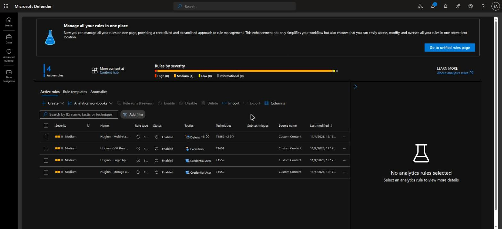

The rule description links back to its source folder, and the query in Sentinel starts with the
same "Validated" header as the file in git:

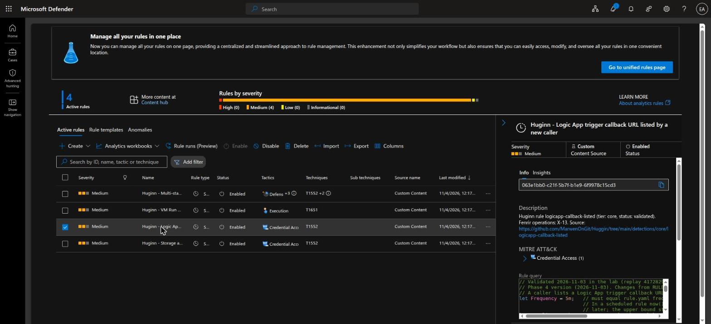

## Every push: CI without Azure

`ci.yml` runs with no Azure login and no secrets: static tests on every rule folder, a KQL syntax
check with Microsoft's own `Kusto.Language` parser, `terraform fmt`/`validate`, tflint and
checkov. It also runs the parser against deliberately broken queries, to prove the syntax check
can fail.

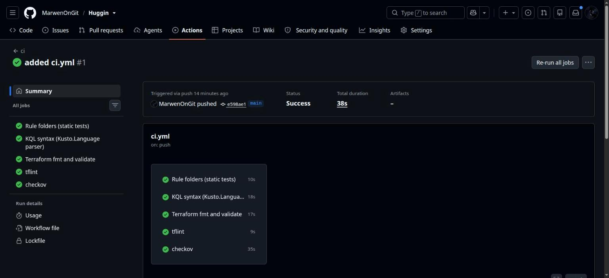

## Every night: replay, then check for the alert

`replay.yml` checks that the deployed rules match git, then signs in through OIDC as a dedicated
lab attacker and performs benign versions of Fenrir's actions on **freshly created** lab
resources. Next it deletes them and polls Sentinel until each expected alert appears.

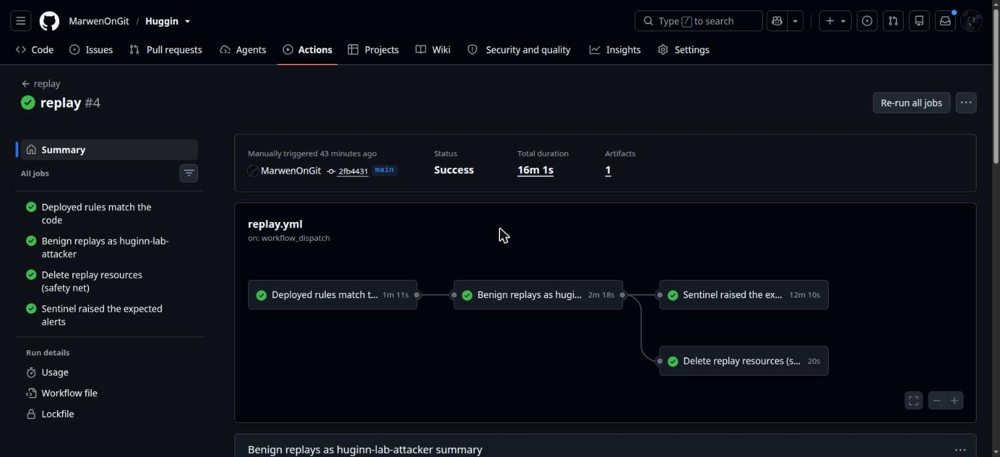

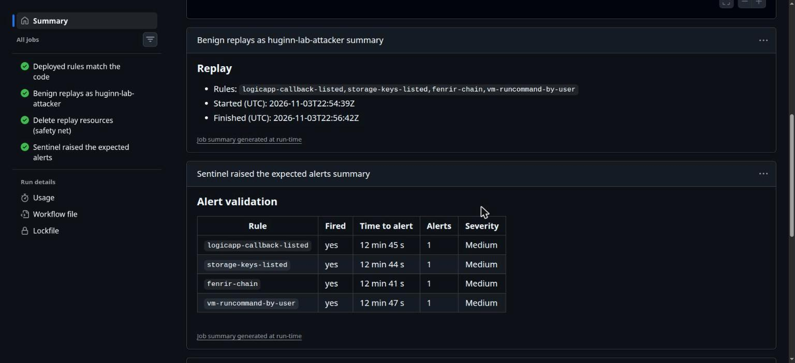

Why fresh resources? Two of the rules alert on a **new** (caller, resource) pair. Replay the same
caller against the same Logic App every night and, from the second night on, the rule correctly
stays silent, and the build turns red for the wrong reason. Each replay creates a uniquely named
resource, so the pair is new every time. The test of that fix is two replays back to back: both
must be green.

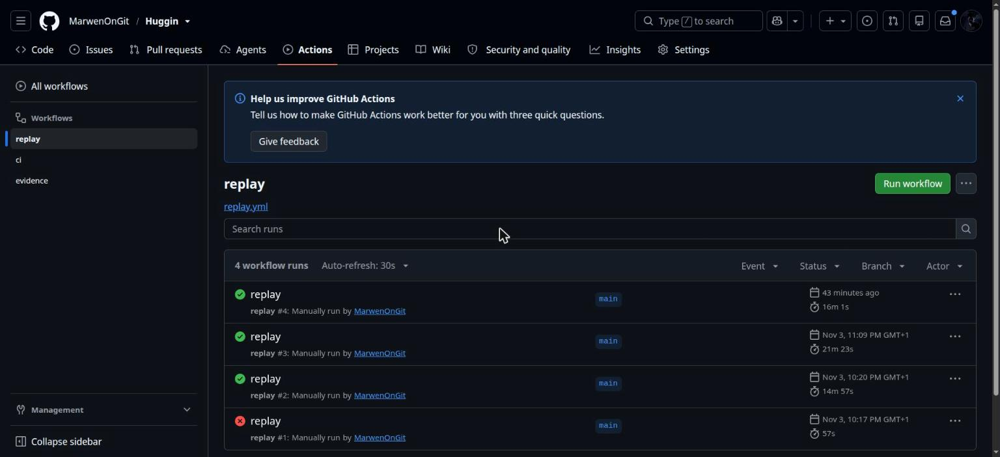

## The bug the lab found: two alerts for one event

My first deployed rules followed Microsoft's sample and selected new rows with
`ingestion_time() > ago(lookback)`. The first green replay raised **2 alerts per event**, and 3
for the chain rule:

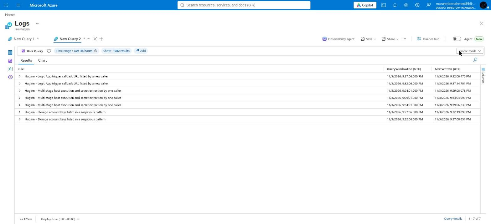

In a scheduled rule, `now()` is the window end, but Sentinel runs the query about 5 minutes later.
A row ingested in that gap counted as new in two runs. The fix is an upper bound,
`ingestion_time() <= now()`. A static test now checks that the KQL `Frequency` matches
`rule.yaml`.

A second trap: one request writes several rows that can be ingested minutes apart. One Run Command
call produced three rows (Start, Accept, Success) with one `CorrelationId`:

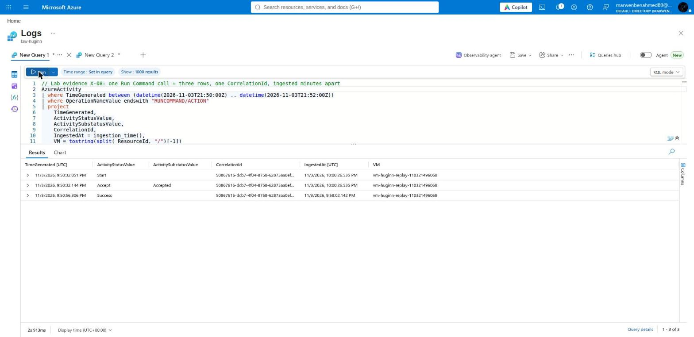

The rules that aggregate now treat a request as new once, when its first row lands. After both
fixes, two back-to-back replays fired every rule with exactly one alert per event.

## What the analyst sees

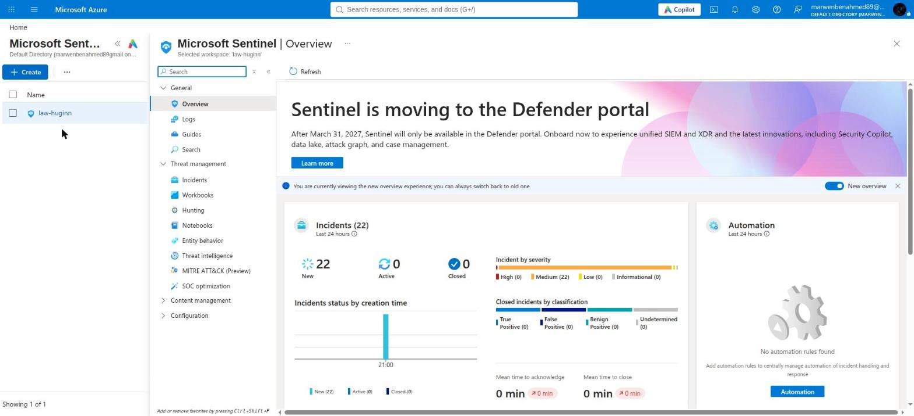

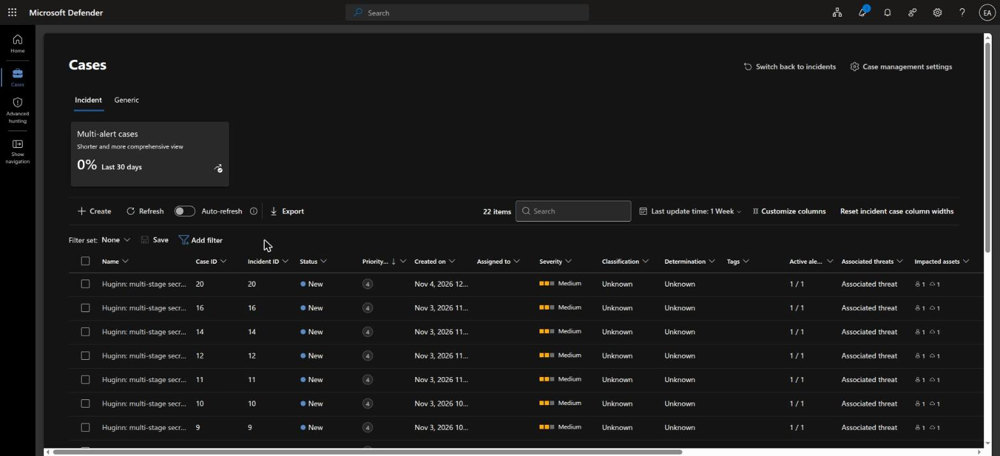

Entities are mapped, so the case graph links the caller to the resource it touched:

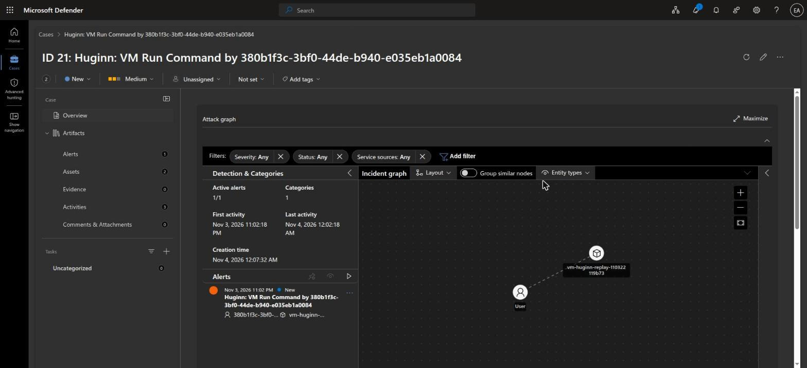

## Numbers

- **Validated rules:** 4 (`logicapp-callback-listed`, `storage-keys-listed`, `fenrir-chain`,
  `vm-runcommand-by-user`), each in two back-to-back replays on 2026-11-03.
- **Time to alert:** 5 to 17 minutes. `AzureActivity` takes 3 to 10 minutes to ingest; the 5-minute
  schedule and Sentinel's 5-minute run delay add the rest.
- **Cost:** about 0 USD per month always on (Activity log ingestion is free), and well under
  1 US cent per nightly replay with the VM.

## What's next

The remaining core rules (X-10, X-14, P-13) need an opt-in lab batch. The identity tier needs an
Entra ID P2 trial and a real Fenrir run. There is also a way to keep a 14-day baseline at 5-minute
speed: Sentinel caps 5-minute rules below a 2-day lookback, so a daily job would write known
(caller, resource) pairs to a watchlist. Code and docs:
[github.com/MarwenOnGit/Huginn](https://github.com/MarwenOnGit/Huginn).
