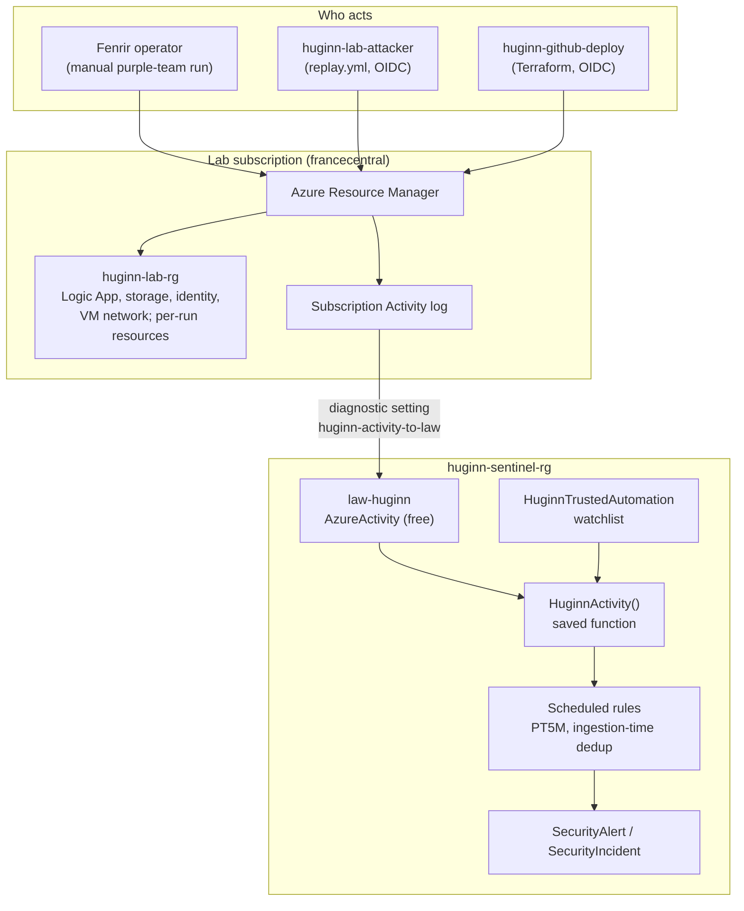

# Huggin architecture

## Data flow



- **Only control-plane writes and actions** reach `AzureActivity`. Reads (all of Fenrir's
  enumeration) never do. See the blind spots in the [README](../README.md).
- **`HuginnActivity(Ops, Lookback)`** normalises rows for every rule: caller object ID, app ID,
  managed-identity resource ID, caller kind (User, ServicePrincipal, ManagedIdentity), whether
  the request ran inside an ARM deployment, whether the (principal, scope, operation) is in the
  watchlist, and the row's ingestion time for deduplication.
- **Rules** run every 5 minutes. A row is "new" when it was ingested in `(now() - 5m, now()]`;
  `now()` is the window end, and Sentinel runs the query about 5 minutes later
  ([TESTING.md](TESTING.md)).

## Test loops

```mermaid
sequenceDiagram
    autonumber
    participant GH as GitHub Actions
    participant TF as Terraform state (deploy identity)
    participant LAB as huginn-lab-rg (lab attacker)
    participant LAW as law-huginn / Sentinel

    Note over GH: ci.yml on every push: static tests, KQL syntax,<br/>fmt, validate, tflint, checkov. No Azure.
    GH->>TF: replay.yml job 1: terraform plan (sentinel, lab)
    TF-->>GH: must be "No changes" (deployed rules = git)
    GH->>LAB: job 2: create fresh Logic App, storage account, VM
    GH->>LAB: listCallbackUrl, listKeys, run-command "hostname" (outputs discarded)
    GH->>LAB: delete them (trap); job 3: cleanup sweep (always)
    LAB-->>LAW: AzureActivity rows (3 to 10 min)
    LAW-->>LAW: rules fire (5-min schedule + 5-min delay)
    GH->>LAW: job 4: validate_alert.py polls SecurityAlert
    LAW-->>GH: alert per rule for the lab attacker, time to alert
    Note over GH: red if any rule did not fire within 30 min
```

## Licence split

| Tier | Tables | Licence | On this tenant |
|---|---|---|---|
| Core | `AzureActivity` | none (Activity log connector, free ingestion) | deployed, 4 rules validated |
| Identity | `SigninLogs`, `AADNonInteractiveUserSignInLogs`, `AADManagedIdentitySignInLogs`, `MicrosoftGraphActivityLogs` | Entra ID P1/P2 and an Entra diagnostic setting | written, not deployable (no P1/P2). `enable_entra_logs` turns the setting on when a licence exists. |
| Identity, `AzureActivity` part | `mi-control-plane-new-ip`, `fenrir-chain` identity pivot | none | deployable; validation needs a real managed identity acting off-host (purple-team run) |
| Beyond Fenrir | `AzureActivity` | none | drafts |

A deployable rule can never reference a licence-gated table: a scheduled rule that queries a
table missing from the workspace fails to deploy. The static tests enforce this.

## Trust boundaries

| Boundary | Control |
|---|---|
| GitHub to Azure | OIDC federated credentials only; no client secret exists for any Huggin app ([ADR 0003](adr/0003-oidc-identities-and-state.md)). Subjects use GitHub's immutable ID form `repo:MarwenOnGit@183097322/Huggin@1444286931:...`. |
| Deploy identity | Main branch only. Contributor on `huginn-sentinel-rg` and `huginn-lab-rg`, Monitoring Contributor on the subscription (Activity log setting), blob access to the state container. It runs `terraform plan` in CI; it never applies. |
| Lab attacker | Only jobs in the `lab-replay` GitHub environment. Contributor on `huginn-lab-rg` only. Never in the watchlist, so everything it does must alert. |
| Replays | Act only on resources they create in `huginn-lab-rg`; refuse any other resource group or subscription; discard every response; never request a managed-identity token; delete through a trap plus a cleanup sweep that fails if anything is left. |
| Bootstrap | Applied by a person (Owner and Global Administrator), locally. CI never holds rights to create apps or role assignments. |
| Watchlist | Exclusions are (principal, scope prefix, operation) triples with an owner, reason and expiry. Never a whole client app ([ADR 0007](adr/0007-watchlist-not-client-app-exclusions.md)). |
| Out of bounds | `fenrir-lab-prod-rg` (the operator's Fenrir lab): Huggin's code and CI never touch it. |
| Purple-team environment | `huginn-purple-rg` (`infra/purple`, ADR 0008): created and destroyed by a person for one run; CI lints it but never applies it, and the replay drift check excludes it. The attacker is a dedicated user with Contributor on that resource group only. |

## Stacks

| Stack | State | Applied by | Contents |
|---|---|---|---|
| `infra/bootstrap` | local (git-ignored) | a person, once | resource groups, state storage, both identities and their roles, `infra/shared/*` |
| `infra/sentinel` | remote (`sentinel.tfstate`) | a person, after a reviewed plan | workspace, Sentinel, Activity log setting, optional Entra setting, function, watchlist, rules from `detections/**/rule.yaml` |
| `infra/lab` | remote (`lab.tfstate`) | a person, after a reviewed plan | Logic App, storage, user-assigned identity, VM network; opt-in X-10, X-14, P-13 targets. The X-08 VM is created and deleted by each run, not by Terraform. |
